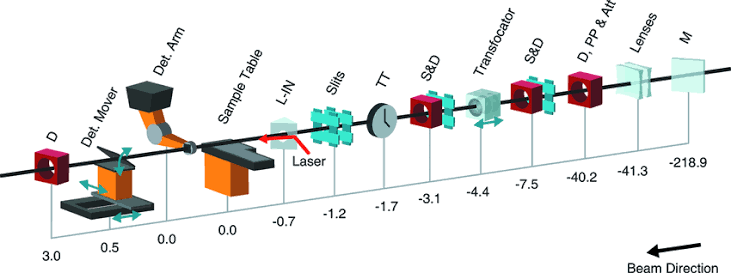

# TFS alignment

## Context

At MFX, the X-ray beam goes through a sequence of optical elements before it
reaches the sample. In the schematic the beam travels from right to left, and
distances are in metres from the sample.



The last focusing element is the **transfocator** (TFS). It is a set of lenses.
Each lens can be inserted into or removed from the beam and has its own x and y
motor, and the whole set sits on a z stage that moves along the beam.

Depending on the beam energy, a different subset of lenses is inserted, together
with one prefocusing lens about 40 m upstream ("Lenses" in the schematic). The
transfocator is then aligned:

* **x, y:** each inserted lens is centered on the beam;
* **z:** the stage is moved so the beam focuses on the sample.

So far this has been done manually. The goal of this project is to automate
this workflow. On the YAG screens, a well-aligned transfocator shows the lens
rings centered and concentric, with the focus at the interaction point.

## This repo

A digital twin of the transfocator, for developing and testing alignment
procedures offline before running them on the instrument. It puts together the
two simulators we already have:

* `twin.tfs`: the hutch-python `tfs` (`tfs.transfocator.Transfocator` from
  [pcdshub/mfx](https://github.com/pcdshub/mfx)) with fake PVs. Same API:
  `tfs.find_best_combo`, `tfs.focus_at`, `tfs.translation.mv`, `tfs.tfs_05.x.mv`, ...
* `twin.mfx_sim`: Matt's MFX wavefront model (`lcls_beamline_toolbox.models.mfx.MFX` from
  [mseaberg/lcls_beamline_toolbox](https://github.com/mseaberg/lcls_beamline_toolbox)).
  Same API: `twin.beamline.DG3_YAG.view_beam()`, `.profile`, `.cx`, `.wx`, ...

Both are built from the same lens radii and positions, so they agree.

Instrument documentation: [MFX Confluence](https://confluence.slac.stanford.edu/display/MFX/MFX@LCLS+Home)
(see 2.3.1 Transfocator, Align CRLs, Calculate Transfocator Combinations).


## Install

macOS or Linux, with [uv](https://docs.astral.sh/uv/) (it fetches Python 3.11 for you;
install it once with `curl -LsSf https://astral.sh/uv/install.sh | sh`):

```bash
git clone https://github.com/amine-lamouchi/tfs_alignment.git
cd tfs_alignment
git submodule update --init      # not --recursive: mfx has a nested private submodule we don't need
uv venv --python 3.11 && source .venv/bin/activate
uv pip install -e external/lcls_beamline_toolbox -e ".[dev]"
pytest
```

No EPICS or SLAC network needed. With conda instead of uv: `conda create -n tfs python=3.11`,
`conda activate tfs`, then the same `pip install` line.

## Usage

```python
from tfs_twin import DigitalTwin, SimCamera

twin = DigitalTwin(9500, N=256, misalignment=50e-6, seed=3)  # like MFX(E0, N=...)
tfs = twin.tfs

tfs.focus_at(energy_eV=9500, wait=True)
tfs.tfs_06.x.mvr(0.02)          # lens motors in mm, as on the instrument
tfs.translation.mv(150)         # z stage in mm

twin.propagate()
twin.beamline.DG3_YAG.view_beam()

camera = SimCamera(twin, "DG3_YAG", noise=True)
image = camera.get_image()      # same call as gigE_camera_accessor.get_image()

twin.report()                   # hidden truth (focus error, lens offsets): for grading only
```

See `notebooks/01_quickstart.ipynb`. `protocols/center_lenses.py` is a baseline
alignment protocol. It only uses `tfs` and `camera.get_image()`, so the same
code runs on the instrument.

## 3D view

```python
from tfs_twin.xrt_view import glow
glow(twin)      # in Jupyter, run %gui qt first so the notebook stays usable
```

Left: the beam line in 3D ([xrt](https://xrt.readthedocs.io) ray tracing).
Right: the YAG you pick, as the operator sees it. It follows the twin as you
move motors. Details, movies and options: [docs/viewer.md](docs/viewer.md).


## Real instrument

In hutch-python (read-only, nothing moves):

```python
from tfs_twin import snapshot, make_tfs_sim
snapshot(tfs)                 # saves snapshots/latest.json; the twin uses it from then on
tfs_sim = make_tfs_sim(tfs)   # offline copy of the live tfs, as with tfs.sim_transfocator
```

Without a snapshot, the twin uses the TFS lens values read off the instrument in
Oct 2025 and Matt's model for the rest of the beam line.

## Layout

```
src/tfs_twin/   geometry.py (lens values), motor_sim.py (offline tfs), twin.py (twin + camera),
                xrt_view.py (3D view)
protocols/      alignment procedures: your work goes here
notebooks/      quickstart
tests/          pytest
docs/           notes.md (background, tasks, things to know), viewer.md (3D view)
external/       mfx and lcls_beamline_toolbox (submodules, don't edit)
```
