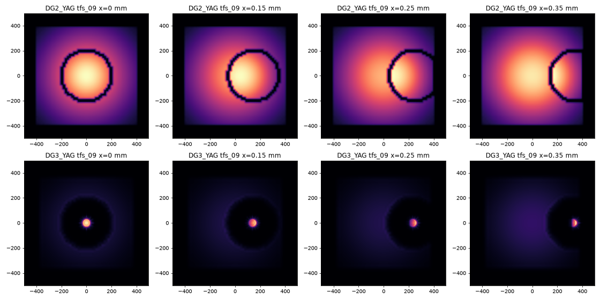

# TFS alignment

Digital twin of the MFX transfocator for developing alignment procedures offline.

**Goal:** focus at the interaction point, with every inserted lens centered on
the beam (on the YAGs, the lens rings are centered and concentric).

The twin puts together the two simulators we already have:

* `twin.tfs`: the hutch-python `tfs` (`tfs.transfocator.Transfocator` from
  [pcdshub/mfx](https://github.com/pcdshub/mfx)) with fake PVs. Same API:
  `tfs.find_best_combo`, `tfs.focus_at`, `tfs.translation.mv`, `tfs.tfs_05.x.mv`, ...
* `twin.mfx_sim`: Matt's MFX wavefront model (`lcls_beamline_toolbox.models.mfx.MFX` from
  [mseaberg/lcls_beamline_toolbox](https://github.com/mseaberg/lcls_beamline_toolbox)).
  Same API: `twin.beamline.DG3_YAG.view_beam()`, `.profile`, `.cx`, `.wx`, ...

Both are built from the same lens radii and positions, so they agree.

Instrument documentation: [MFX Confluence](https://confluence.slac.stanford.edu/display/MFX/MFX@LCLS+Home)
(see 2.3.1 Transfocator, Align CRLs, Calculate Transfocator Combinations).



## Install

```bash
git clone https://github.com/amine-lamouchi/tfs_alignment.git
cd tfs_alignment
git submodule update --init      # not --recursive: mfx has a nested private submodule we don't need
python3.11 -m venv .venv && source .venv/bin/activate     # or a conda env with python 3.11
pip install -e external/lcls_beamline_toolbox -e ".[dev]"
pytest
```

No EPICS or SLAC network needed. `mfx` and `lcls_beamline_toolbox` are git
submodules in `external/`. `tfs` isn't pip-installable, so `tfs_twin` adds
`external/mfx` to the path (or `$TFS_MFX_PATH` if set).

## Usage

```python
from tfs_twin import DigitalTwin, SimCamera

twin = DigitalTwin(9500, N=256, misalignment=50e-6, seed=3)  # like MFX(E0, N=...)
tfs = twin.tfs

tfs.focus_at(energy_eV=9500, wait=True)
tfs.tfs_06.x.mvr(0.02)          # lens motors in mm, as on the instrument
tfs.translation.mv(150)         # z stage in mm

twin.propagate()
twin.beamline.DG3_YAG.view_beam()

camera = SimCamera(twin, "DG3_YAG", noise=True)
image = camera.get_image()      # same call as gigE_camera_accessor.get_image()

twin.report()                   # hidden truth (focus error, lens offsets): for grading only
```

See `notebooks/01_quickstart.ipynb`. `protocols/center_lenses.py` is a baseline
alignment protocol. It only uses `tfs` and `camera.get_image()`, so the same
code runs on the instrument.

## Real instrument

In hutch-python (read-only, nothing moves):

```python
from tfs_twin import snapshot, make_tfs_sim
snapshot(tfs)                 # saves snapshots/latest.json; the twin uses it from then on
tfs_sim = make_tfs_sim(tfs)   # offline copy of the live tfs, as with tfs.sim_transfocator
```

Without a snapshot, the twin uses lens values read off the instrument in Oct 2025.

## Layout

```
src/tfs_twin/   geometry.py (lens values), motor_sim.py (offline tfs), twin.py (twin + camera)
protocols/      alignment procedures: your work goes here
notebooks/      quickstart
tests/          pytest
docs/           notes.md (background, tasks, things to know)
external/       mfx and lcls_beamline_toolbox (submodules, don't edit)
```
