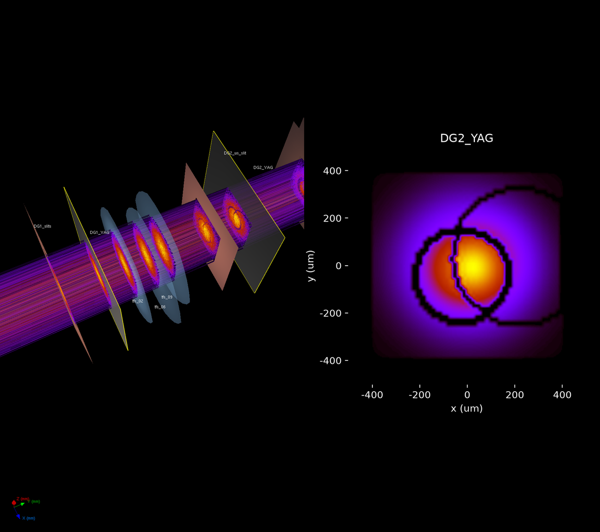

# MFX Digital Twin

A simulated MFX transfocator to develop and test automated alignment procedures.

## What's in this repo

* `twin.tfs`: the hutch-python `tfs` with simulated motors, with the same API as on the instrument.
* `twin.mfx_sim`: Matt Seaberg's wavefront model of the beamline, which gives the YAG images.
* A 3D viewer of the beamline next to the YAG of your choice.

Alignment protocols that only use `tfs` and `camera.get_image()` run unchanged on
the instrument. Instrument documentation: [MFX Confluence](https://confluence.slac.stanford.edu/display/MFX/MFX@LCLS+Home).

## Install

macOS or Linux, with [uv](https://docs.astral.sh/uv/) (it fetches Python 3.11 for you;
install it once with `curl -LsSf https://astral.sh/uv/install.sh | sh`):

```bash
git clone https://github.com/amine-lamouchi/tfs_alignment.git
cd tfs_alignment
git submodule update --init      # not --recursive: mfx has a nested private submodule we don't need
uv venv --python 3.11 && source .venv/bin/activate
uv pip install -e external/lcls_beamline_toolbox -e ".[dev]"
pytest
```

No EPICS or SLAC network needed. With conda instead of uv: `conda create -n tfs python=3.11`,
`conda activate tfs`, then the same `pip install` line.

## Usage

```python
from tfs_twin import DigitalTwin, SimCamera

twin = DigitalTwin(9500, N=256, misalignment=50e-6, seed=3)  # like MFX(E0, N=...)
tfs = twin.tfs

tfs.focus_at(energy_eV=9500, wait=True)
tfs.tfs_06.x.mvr(0.02)          # lens motors in mm, as on the instrument
tfs.translation.mv(150)         # z stage in mm

twin.propagate()
twin.beamline.DG3_YAG.view_beam()

camera = SimCamera(twin, "DG3_YAG", noise=True)
image = camera.get_image()      # same call as gigE_camera_accessor.get_image()

twin.report()                   # hidden truth (focus error, lens offsets): for grading only
```

See `notebooks/01_quickstart.ipynb`. `protocols/center_lenses.py` is a baseline
alignment protocol. It only uses `tfs` and `camera.get_image()`, so the same
code runs on the instrument.

## 3D view

```python
from tfs_twin.xrt_view import glow
glow(twin)      # in Jupyter, run %gui qt first so the notebook stays usable
```

Left: the beam line in 3D ([xrt](https://xrt.readthedocs.io) ray tracing).
Right: the YAG you pick, as the operator sees it. It follows the twin as you
move motors. Details, movies and options: [docs/viewer.md](docs/viewer.md).



## Real instrument

In hutch-python (read-only, nothing moves):

```python
from tfs_twin import snapshot, make_tfs_sim
snapshot(tfs)                 # saves snapshots/latest.json; the twin uses it from then on
tfs_sim = make_tfs_sim(tfs)   # offline copy of the live tfs, as with tfs.sim_transfocator
```

Without a snapshot, the twin uses the TFS lens values read off the instrument in
Oct 2025 and Matt's model for the rest of the beam line.

## Layout

```
src/tfs_twin/   geometry.py (lens values), motor_sim.py (offline tfs), twin.py (twin + camera),
                xrt_view.py (3D view)
protocols/      alignment procedures: your work goes here
notebooks/      quickstart
tests/          pytest
docs/           notes.md (background, tasks, things to know), viewer.md (3D view)
external/       mfx and lcls_beamline_toolbox (submodules, don't edit)
```
