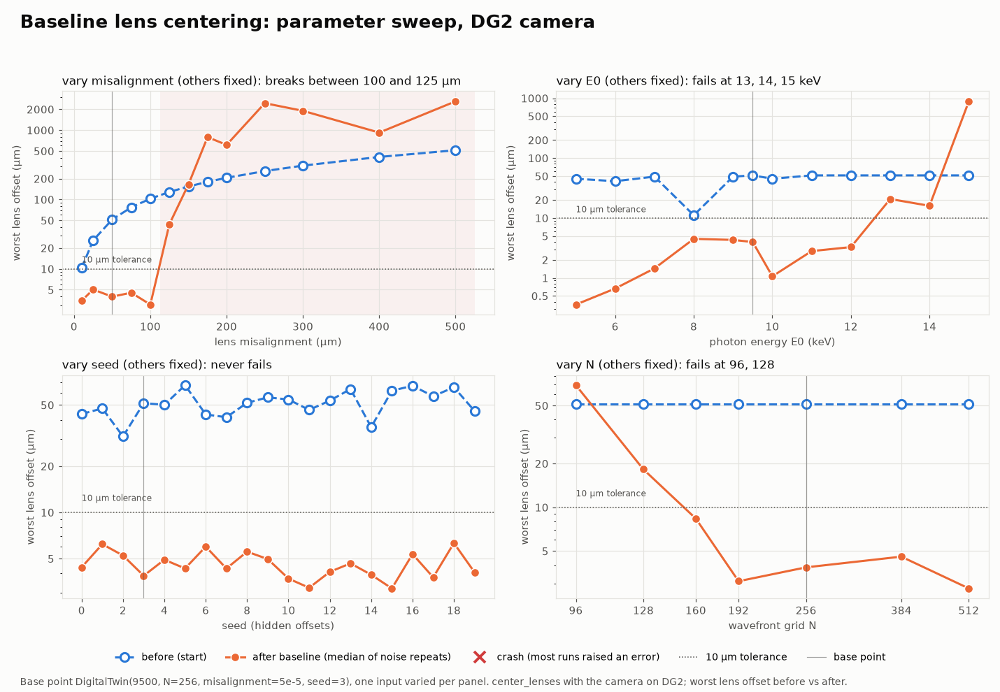
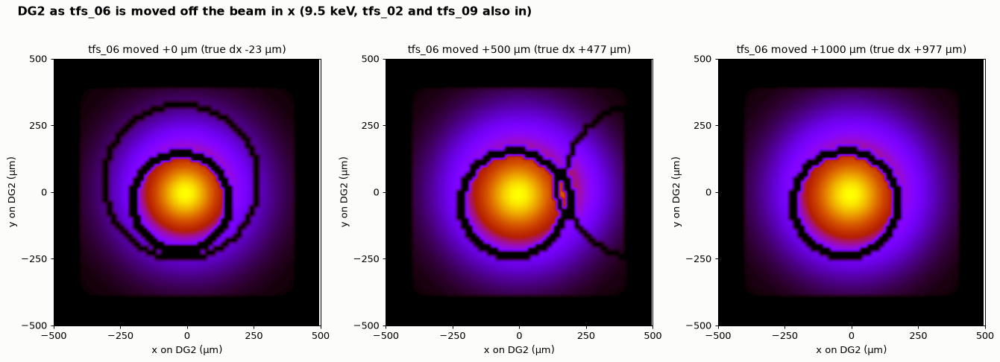
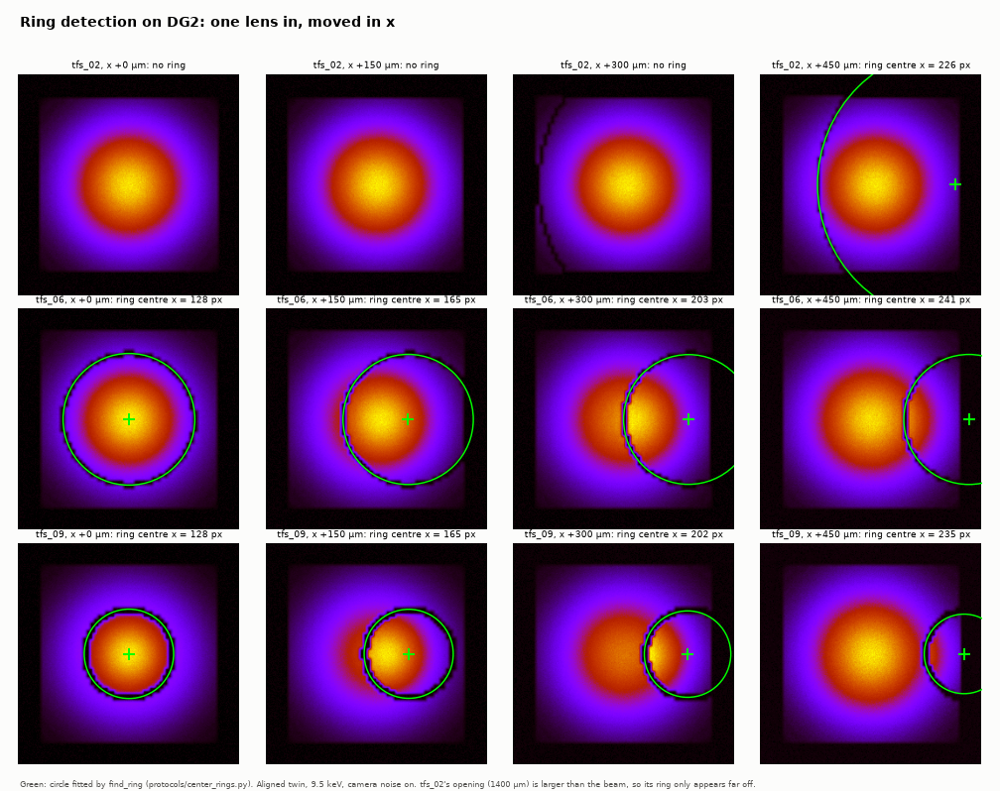
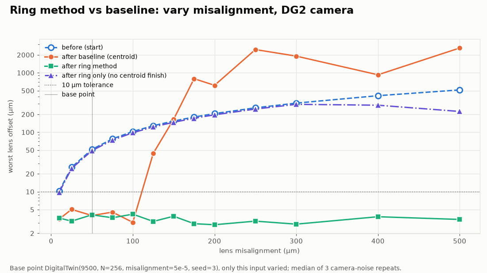
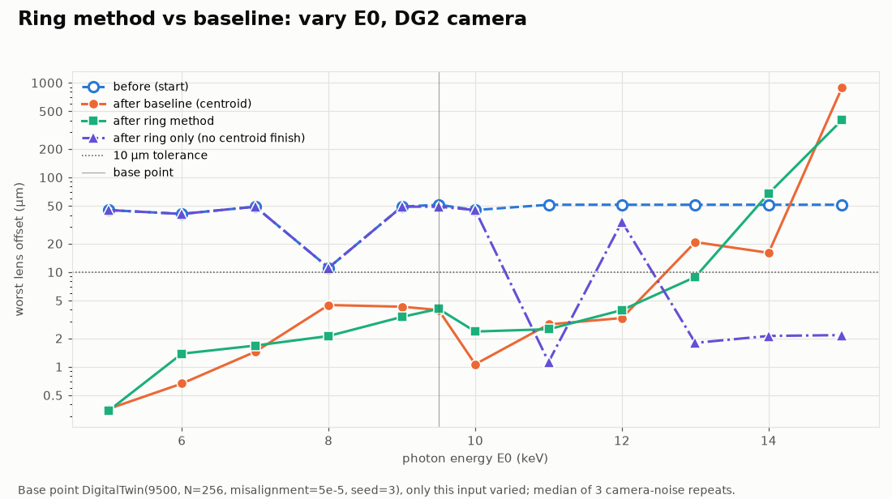

# Lens-centering protocols: analysis

Two ways to center the TFS lenses on the beam, tested on the digital twin:

1. **Baseline (centroid)**: [`protocols/center_lenses.py`](../protocols/center_lenses.py)
2. **Ring method (aperture shadow)**: [`protocols/center_rings.py`](../protocols/center_rings.py)

How each method works, step by step with figures: [protocols/README.md](../protocols/README.md).
Both only use `tfs` and `camera.get_image()`, so they run unchanged on the instrument.
Summary: the baseline works only for small misalignment (≤ 100 µm on DG2). The ring method works up to
500 µm, but neither works yet at 14–15 keV on DG2.

## Setup

- **Base twin:** `DigitalTwin(9500, N=256, misalignment=5e-5, seed=3)`, then `tfs.focus_at(energy_eV=E0)`.
  At 9.5 keV this inserts tfs_02, tfs_06 and tfs_09 (openings 1400, 623 and 440 µm) plus a prefocus lens.
- **Inputs:** `misalignment` (how far the lenses can start off, ± this value), `E0` (photon energy),
  `seed` (which random lens offsets are drawn), `N` (simulation grid size). We change **one at a time**,
  the others stay at the base values. Note that `focus_at` picks different lenses at each E0.
- **Camera:** `SimCamera(twin, "DG2_YAG" or "DG3_YAG", noise=True)`: shot noise and a background of
  20 counts, ~4000 counts at the peak. DG2 and DG3 are 1 mm wide (±500 µm).
- **Score:** *worst lens offset* = for each inserted lens, its distance from the beam
  √(dx² + dy²) from `twin.lens_offsets()`, then the largest. This is the hidden truth: the protocols
  never use it.
- **Tolerance:** 10 µm. Our choice, not an instrument requirement (the repo test uses 5 µm for one lens).
- **Repeats:** misalignment and E0 points are run with 3 camera-noise seeds; plots show the median.
  Seed and N points are run once.
- **The twin's motors are ideal:** moves are instant and exact, the lens x/y motors have no travel
  limits, and there is no beam jitter unless we add it.

## 1. Baseline: centroid method

For each lens, one at a time:
1. take all lenses out and record the beam centroid (the target);
2. put the lens in, move its x motor 20 µm and measure how far the centroid moves (the gain);
3. move to where the centroid should be back on the target; repeat 3 times, then the same for y;
4. put the other lenses back.

The centroid is the intensity-weighted average position of the beam, not the brightest pixel.

### Parameter sweeps

| Input | DG2: works (< 10 µm) | DG2: breaks | DG3: works | DG3: breaks |
|---|---|---|---|---|
| misalignment | ≤ 100 µm (2–5 µm) | 125 µm; worse than the start from 150 µm; crashes from 200 µm | ≤ 125 µm (~2 µm) | from 150 µm, not monotonic (works again at 175 and 250 µm) |
| E0 | 5–12 keV | 13–15 keV (up to 920 µm) | all but 6 keV | 6 keV (46–296 µm) |
| seed (0–19) | all (3–6 µm) | never | all (1.7–3.2 µm) | never |
| N | ≥ 192 | erratic below 192 (grid too coarse: a simulation artefact) | ≥ 48 | 32 (the model itself fails) |

DG3 is more accurate (~2 µm vs ~4 µm) because it is further from the lenses: the same lens move shifts
the beam more there. DG3 plot: [figures/sweep_baseline_DG3.png](figures/sweep_baseline_DG3.png).
Single-input plots: [misalignment](figures/sweep_baseline_DG2_misalignment.png),
[E0](figures/sweep_baseline_DG2_E0.png).

### Failure mode 1: large misalignment

When a lens is far off, only its edge touches the beam:
1. **Wrong gain:** the 20 µm test step barely moves the centroid, the gain is ~0, so the computed move
   is huge (tfs_02 jumps from +414 to −982 µm).
2. **False success:** a lens that misses the beam does not deflect it, so the centroid lands back on the
   target and the protocol stops. Above, at +1000 µm, the centroid is within 5 µm of the centered case;
   only the ring shows that the lens moved.

GIF (DG2, 0.7 s per frame, + measured centroid, o target):
[gifs/baseline_misaligned_500um_DG2.gif](gifs/baseline_misaligned_500um_DG2.gif). Normal run for
comparison: [gifs/baseline_DG2.gif](gifs/baseline_DG2.gif).

### Failure mode 2: high energy on DG2

At 15 keV each lens bends the beam very little and DG2 is close to the lenses, so the centroid signal is
about the size of the camera noise. One noisy gain sends tfs_08 from +7 to −915 µm, then the false success
keeps it there. GIF: [gifs/baseline_15keV_DG2.gif](gifs/baseline_15keV_DG2.gif). DG3, further away,
works at 15 keV.

### Stress tests (DG3 camera, one run each)

Each case adds one stress around the unchanged protocol ([stress.py](stress.py)).

| Case | Worst lens offset, before → after |
|---|---|
| Normal | 52 → **1.5 µm** |
| Beam moved 30 µm only on the lens-out reference image | 52 → **325 µm** |
| Beam jitter 30 µm rms on every image | 52 → **6 mm**, crash |
| Misalignment ±300 µm | 309 → **1740 µm** |
| Misalignment ±500 µm | 515 → **4.5 mm**, crash |
| Camera rotated 30° | 52 → **33 µm** |
| Camera rotated 90° | 52 → **5.3 mm**, crash |
| Low light (~40 counts peak) | 52 → **285 µm** |

The beam is moved with `twin.mfx_sim.undulator_pointing(ax, ay)`: 0.11 µrad ≈ 30 µm at the lenses.
Not checked: how much the beam really moves at MFX.

## 2. Ring method: aperture shadow

Part of the beam passes outside a lens's opening and is not focused by it, so the edge of the opening
casts a thin dark ring on the YAG. The ring is the lens's shadow: it moves with the lens, even when the
centroid does not.

For each lens, one at a time (others out, as the baseline):
1. take all lenses out and record the beam centroid (the target);
2. put the lens in and **find its ring**: a morphological closing picks out thin dark lines (not the
   edge of the beam), then a circle is fitted to them; a partial arc is enough (`find_ring`);
3. move each motor 50 µm once to measure how far the ring moves;
4. move the lens so the ring's centre lands on the target (at most 0.2 mm per move), and repeat until
   within 1 pixel;
5. finish with centroid steps as in the baseline, with moves capped at 0.2 mm. This covers lenses whose
   opening is larger than the beam, which show no ring.

The ring centre follows the lens in a straight line, ~0.25 pixel per µm, also for partial arcs.

### Ring method vs baseline (DG2)

| Input | Baseline | Ring method | Ring only (no step 5) |
|---|---|---|---|
| misalignment 10–500 µm | breaks after 100 µm (up to 2.8 mm) | **2–5 µm everywhere** | tfs_02 never moves (no ring) |
| E0 5–12 keV | 0.3–4.5 µm | 0.3–4.3 µm | lenses with no ring are not corrected |
| E0 13 keV | 7–453 µm | 6–13 µm | ~2 µm |
| E0 14–15 keV | 13–920 µm | 20–467 µm (fails) | **~2 µm** |

**Ablation (ring only):** without the centroid finish, high energy is fixed, so the finish is what
fails at 14–15 keV. But lenses that show no ring (tfs_02, and several lenses at 5–10 keV where the beam is
small) are never moved. Next step: run the centroid finish only for lenses where no ring was found.

## Reproduce

From the repo root, with the environment active (`source .venv/bin/activate`). Everything runs on your
machine, one process at a time; run times are on a laptop.

| Command (in `analysis/`) | What | Time |
|---|---|---|
| `python sweep.py misalignment --camera DG2_YAG --method baseline` | one sweep: 39 runs | ~7 min |
| `python sweep.py E0 --method ring` | one sweep: 36 runs | ~7 min |
| `python sweep.py seed` / `python sweep.py N` | 20 / 10 runs | ~3.5 / ~2 min |
| `python sweep.py <param> ... --resume` | finish a stopped sweep | |
| `python plot_sweep.py --camera DG3_YAG`, `python plot_compare.py` | plots from `results/` | seconds |
| `python stress.py` | stress tests (all cases) | ~1.5 min |
| `python show_find_ring.py`, `python show_lens_off_beam.py` | the two image figures | ~15 s |
| `python record_baseline_gif.py gifs/x.gif --misalignment 5e-4 --yag DG2_YAG --camera DG2_YAG` | a GIF (opens a window) | ~1 min |

Methods for `sweep.py --method`: `baseline`, `ring`, `ring_only`. Raw results: `results/<camera>/*.json`.

