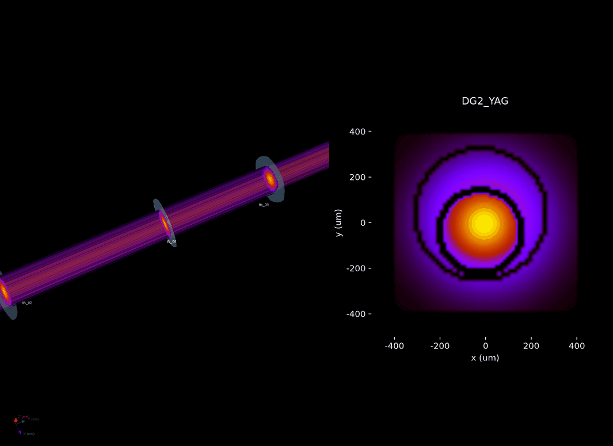

# 3D view

`glow(twin)` opens a window with two panels:

* **Left**: the beam line in 3D, ray-traced with [xrt](https://xrt.readthedocs.io):
  inserted lenses, stage, lens offsets and energy from the twin, with the YAGs,
  slits and mirrors from Matt's model.
* **Right**: the YAG picked in the first drop-down (DIA, DG1, DG2, IP, DG3), as
  the operator sees it. The second drop-down picks how it is computed:
  "wavefront" (default: Matt's model, with diffraction, the same image as
  `SimCamera`) or "ray trace" (faster, from the rays on the left).

```python
from tfs_twin.xrt_view import glow
glow(twin)                                    # 3D + DG2
glow(twin, yag="DG3_YAG", mode="ray trace")
glow(twin, zoom_on="stack")                   # inserted TFS lenses, with their spacing visible
glow(twin, zoom_on="tfs_06")                  # one inserted lens, true scale
glow(twin, yag=None)                          # 3D only
```

Rotate and zoom with the mouse. `viewer.grab().save("state.png")` saves both
panels as an image.

## Jupyter

Run `%gui qt` once before `glow`. The window then stays open while you keep
working, and redraws within a second when you move motors, insert lenses or
change the energy, so you can watch a protocol run:

```python
%gui qt
viewer = glow(twin)
tfs.tfs_06.x.mvr(0.05)          # the window follows
```

Without `%gui qt` (or in a script), `glow` blocks until the window is closed.
Quick demo from a terminal: `python -m tfs_twin.xrt_view 9500`.

## Movies

`movie` records a GIF of a scan written with the usual `tfs` calls, with the
same two panels. Lenses can move during the scan (x/y motors, stage), but not
be inserted or removed.

```python
import numpy as np
from tfs_twin.xrt_view import movie

x0 = tfs.tfs_06.x.position
def scan(tfs):
    for x in x0 + np.linspace(-0.3, 0.3, 16):
        tfs.tfs_06.x.mv(x)
        yield                   # one frame

movie(twin, scan, "tfs_06_x.gif", yag="DG2_YAG", zoom_on="stack")
```



## What you are looking at

* In the default view the beam axis is squashed 800x relative to x and z, so
  lenses 75 mm apart look stacked; `zoom_on="stack"` squashes it only 50x.
* Colours on the left show the local ray density with Matt's colormap: the
  core of the beam is brightest.
* The beam line is unfolded into a straight line (a mirror is drawn as its
  clear aperture), and ray tracing has no diffraction: use the wavefront mode
  for beam profiles.

## Troubleshooting

* *"The 3D view needs a screen"*: there is no display (e.g. JupyterLab on a
  remote server). Use a machine with a screen, or ssh -X / NoMachine. Everything
  else in `tfs_twin` works without one.
* A warning *"3D view: ... skipped"*: the installed xrt differs from the tested
  one (1.6.2) and a cosmetic touch (labels, colours, see-through lenses) was
  turned off. The viewer still works.
