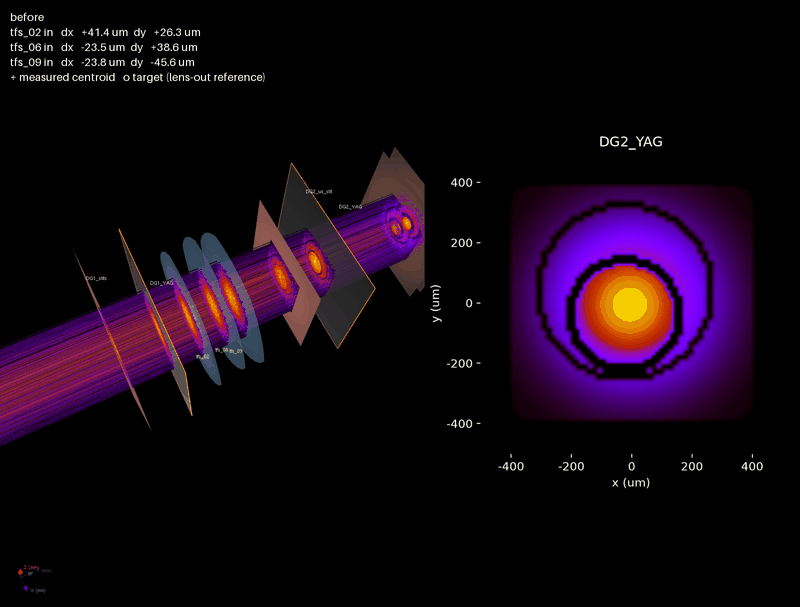
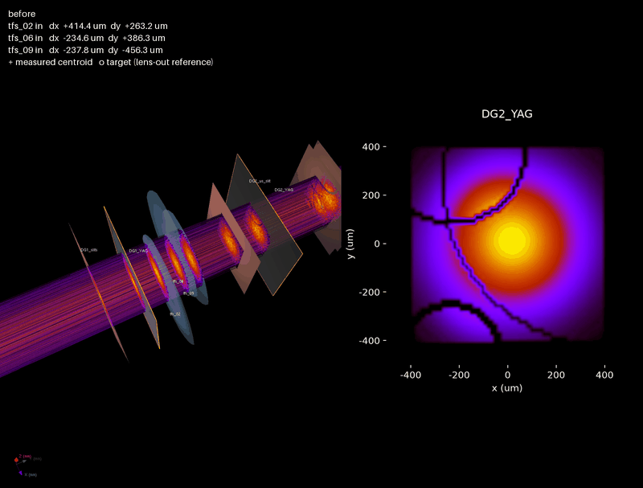
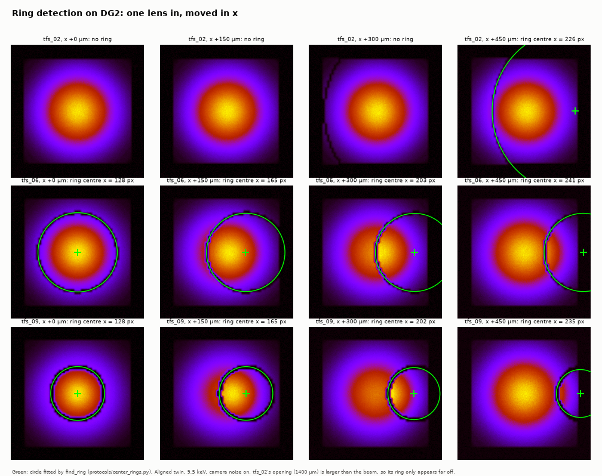
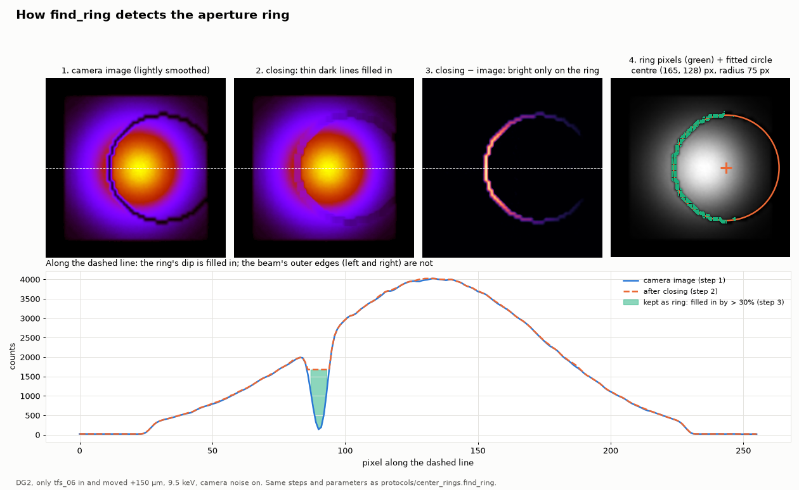
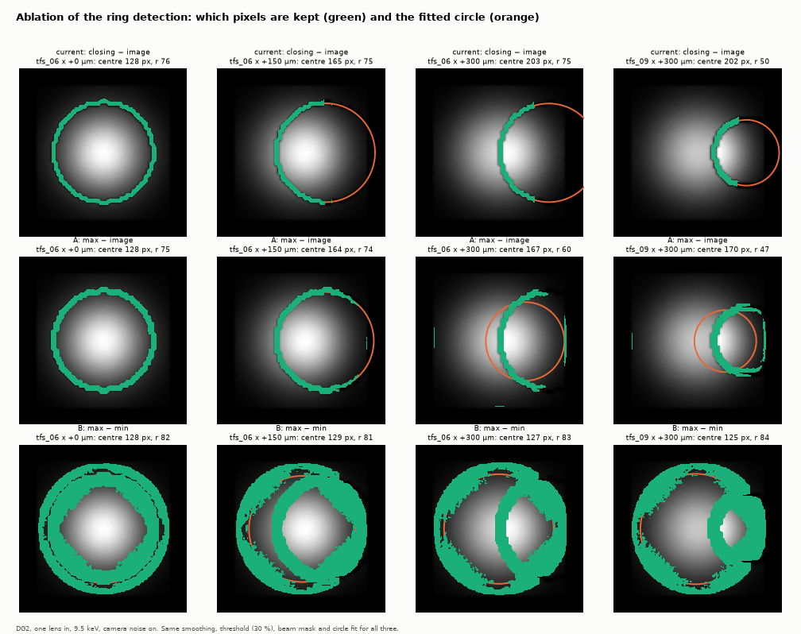
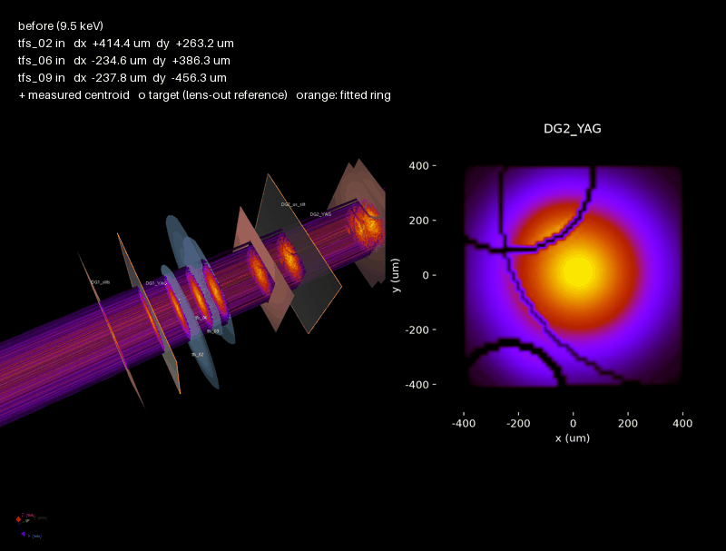
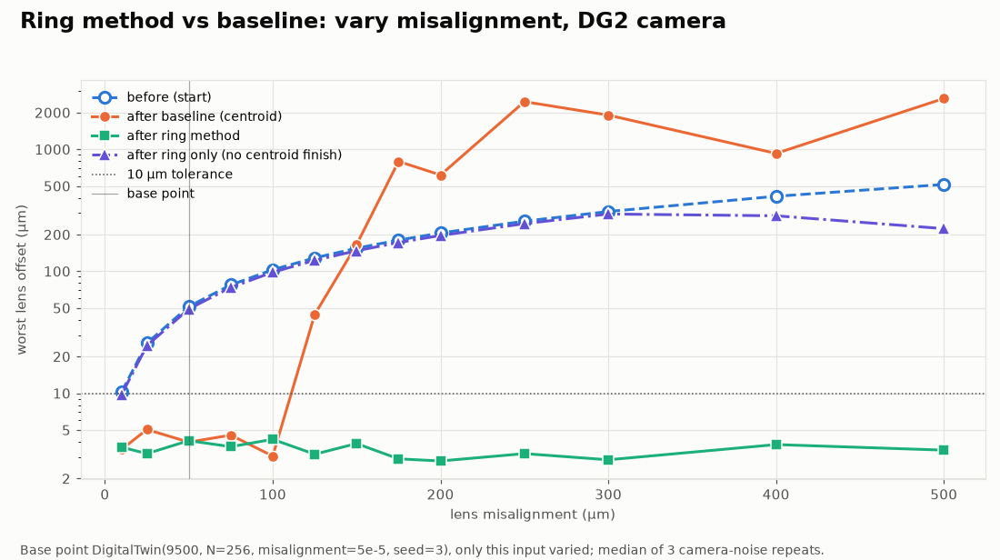

# Centering protocols

Both center **one lens at a time** (the others are taken out) using only `tfs` and `camera.get_image()`,
so they run unchanged on the instrument. Results: [analysis/README.md](../analysis/README.md).

```python
from protocols.center_lenses import center_lenses          # 1. baseline
from protocols.center_rings import center_lenses_ring      # 2. ring method
center_lenses_ring(tfs, camera, lenses=[lens for lens in tfs.tfs_lenses if lens.inserted])
```

## 1. Baseline: `center_lenses.py`

1. All lenses out: the beam's centroid is the **target**.
2. Lens in: move x by 20 µm and measure how far the centroid moves (the **gain**).
3. Move so the centroid lands on the target. 3 times, then the same for y.

Fails when the lens is far off: the centroid barely moves, so the gain is ~0 and the move would be huge.
Each move is capped at 0.2 mm, so the lens stays within the motor's limits.

**Works:** lenses up to ±50 µm off (`misalignment=5e-5`, DG2): all end within ~5 µm. +: centroid, o: target.



**Fails:** lenses up to ±500 µm off (`misalignment=5e-4`, DG2): the lenses jump off the beam and end
0.9–1.8 mm off, while + still lands on o.



## 2. Ring method: `center_rings.py`

The edge of the lens's opening casts a **thin dark ring** on the YAG: the lens's shadow. It moves with the
lens even when the centroid does not. The lens is centered when its ring is centered on the beam.



### Step A: find the ring (`find_ring`)



1. **Smooth** the image (1 pixel blur) against noise.
2. **Erase the ring**: each pixel takes the brightest value in its 9×9 window, then the darkest value of
   that result (a *closing*). Thin dark lines are filled in; wide dark areas and the beam's edges are not.
3. **Subtract** the original: the ring pixels are those raised by more than 30%.
4. **Fit a circle** to them (least squares); a partial arc is enough.

Parameters: window 9 px, contrast 30%, at least 40 pixels, beam mask 10% of the peak (set by hand for DG2).

**Ablation:** both halves of step 2 are needed
([ablation_find_ring.py](../analysis/ablation_find_ring.py)).

| Ring pixels from | Follows the lens? (~0.25 px/µm) | Finds |
|---|---|---|
| closing − image (current) | yes | the ring |
| brightest − image | no | the ring, then the beam's edges from ~300 µm |
| brightest − darkest | no | the beam's outline |



### Step B: center the lens (`center_lens_ring`)

1. All lenses out: the beam's centroid is the **target**.
2. Lens in: find its ring.
3. **Calibrate**: move x then y by 50 µm, measure how far the ring moves.
4. **Center**: move the ring's centre onto the target (≤ 0.2 mm per move), up to 6 times, until within 1 px.
With no ring (opening wider than the beam) it says so and leaves the lens for the baseline.

## Results

Ring method on DG2 with lenses up to ±500 µm off (`misalignment=5e-4`, `seed=3`): all three lenses end
within 4.5 µm. Orange: fitted ring, o: target, +: centroid.



Worst lens offset after centering, vs misalignment (DG2, median of 3 noise repeats): the baseline breaks
after 100 µm, the ring method stays at 2–5 µm up to 500 µm.


